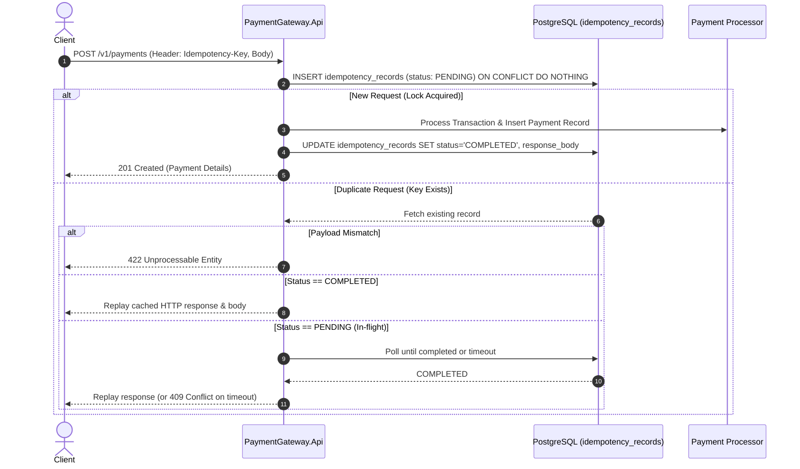
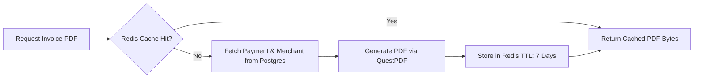

# PaymentGateway.Api 💳

A high-performance, resilient Payment Gateway API built on **.NET 9**, designed with fintech-grade guarantees including **strict request idempotency**, **Redis caching**, **PostgreSQL persistence**, and **on-the-fly PDF invoice generation** using **QuestPDF**.

---

## 🚀 Key Features

- **Strict Request Idempotency**
  - Guaranteed exactly-once execution semantics using per-merchant idempotency keys.
  - SHA-256 payload fingerprinting to detect payload tampering or key reuse conflicts.
  - Concurrency lock handling and polling fallback for in-flight duplicate requests.
  - Instant replay of historical HTTP status and response bodies for completed transactions.
- **Dynamic PDF Invoice & Receipt Engine**
  - On-demand PDF receipt generation using **QuestPDF**.
  - Configurable receipt design (custom accent colors, optional service tax calculations, watermarks).
  - Multi-tier caching in **Redis** with SHA-256 option hashes and 7-day TTL to minimize CPU overhead.
- **Containerized Infrastructure**
  - Automated local development orchestration via `docker-compose`.
  - **PostgreSQL 16** with schema migrations and merchant seeding.
  - **Redis** for distributed key-value caching.
  - **Nginx** reverse proxy setup.
- **Modern Minimal API Architecture**
  - Lightweight, modular feature-based vertical slice design under `Features/`.
  - Native asynchronous I/O with cancellation token propagation.

---

## 🛠️ Tech Stack

| Category | Technology |
| :--- | :--- |
| **Runtime & Framework** | [.NET 9 (C# 13)](https://dotnet.microsoft.com/) - ASP.NET Core Minimal APIs |
| **Primary Database** | [PostgreSQL 16](https://www.postgresql.org/) via [`Npgsql`](https://www.npgsql.org/) (High-performance ADO.NET) |
| **Cache & Key-Value Store** | [Redis](https://redis.io/) via [`StackExchange.Redis`](https://stackexchange.github.io/StackExchange.Redis/) |
| **Document Generation** | [QuestPDF](https://www.questpdf.com/) (Fluent layout engine) |
| **Reverse Proxy** | [Nginx](https://nginx.org/) |
| **Containers** | Docker & Docker Compose |

---

## 📐 Architecture & Flows

### 1. Payment Idempotency Lifecycle



### 2. Cached Invoice Retrieval



---

## 📁 Project Structure

```text
PaymentGateway.Api/
├── Features/
│   ├── Idempotency/
│   │   └── IdempotencyService.cs    # Atomic locking, SHA-256 payload hashing, response replay
│   ├── Invoice/
│   │   ├── InvoiceEndpoints.cs      # Receipt download endpoints
│   │   └── InvoiceService.cs        # QuestPDF layout, tax logic & Redis cache layer
│   ├── Payment/
│   │   ├── CreateChargeRequest.cs   # Payment request DTO
│   │   └── PaymentEndpoints.cs      # Payment processing endpoints (/v1/payments)
│   └── Webhook/
│       └── InitPaymentHook.cs       # Webhook notification scaffolding
├── configs/
│   └── nginx.conf                   # Nginx reverse proxy configuration
├── docker/
│   └── init.sql                     # Postgres schema, indexes & default seed data
├── docker-compose.yml               # Postgres, Redis, and Nginx container definitions
├── psql.ps1                         # PowerShell utility script to execute queries in Postgres
├── Program.cs                       # App entry point, DI container & route registration
├── PaymentGateway.Api.csproj        # Dependencies and SDK target
└── .env                             # Environment configuration
```

---

## ⚙️ Getting Started

### Prerequisites

- [.NET 9.0 SDK](https://dotnet.microsoft.com/download/dotnet/9.0)
- [Docker Desktop](https://www.docker.com/products/docker-desktop/)
- PowerShell (Windows) or bash (macOS/Linux)

### 1. Clone & Configure Environment

Clone the repository and inspect the `.env` file in the root directory:

```env
POSTGRES_DB=app_db
POSTGRES_USER=postgres
POSTGRES_PASSWORD=password
```

### 2. Start Infrastructure Containers

Start PostgreSQL, Redis, and Nginx in the background:

```powershell
docker compose up -d
```

Verify that the containers are healthy:

| Service | Host Port | Internal Port | Description |
| :--- | :--- | :--- | :--- |
| **PostgreSQL** | `5431` | `5432` | Relational database (schema initialized automatically via `docker/init.sql`) |
| **Redis** | `6379` | `6379` | In-memory cache for generated PDF documents |
| **Nginx** | `80` | `80` | HTTP proxy / Web server |

### 3. Run the API

Restore dependencies and launch the API locally:

```powershell
dotnet restore
dotnet run
```

The application will start listening on:
- HTTP: `http://localhost:5248`
- HTTPS: `https://localhost:7151`

---

## 📮 API Endpoints & Usage

### 1. Health Check

```http
GET /
```

**Response (`200 OK`)**:
```text
Payment Gateway API is running!
```

---

### 2. Create Payment (Charge)

Executes a payment charge with required idempotency validation.

```http
POST /v1/payments
Content-Type: application/json
Idempotency-Key: <unique-uuid-or-key>
```

#### Request Payload
```json
{
  "amount": 25000,
  "currency": "USD",
  "customerEmail": "alex.doe@example.com",
  "description": "Premium Subscription #4821"
}
```

> **Note**: `amount` is represented in the smallest currency unit (e.g., `25000` = $250.00).

#### Example cURL Command
```bash
curl -i -X POST http://localhost:5248/v1/payments \
  -H "Content-Type: application/json" \
  -H "Idempotency-Key: pay-tx-940201" \
  -d '{
    "amount": 25000,
    "currency": "USD",
    "customerEmail": "alex.doe@example.com",
    "description": "Order #1001 payment"
  }'
```

#### Response (`201 Created`)
```json
{
  "id": "e93f3b90-1c94-4d89-b873-c4c0b4904bf7",
  "status": "SUCCESSS",
  "amount": 25000,
  "currency": "USD",
  "customer_email": "alex.doe@example.com"
}
```

#### Error Responses
- `400 Bad Request`: Missing `Idempotency-Key` header.
- `422 Unprocessable Entity`: The same `Idempotency-Key` was submitted with a different request payload.
- `409 Conflict`: Request timed out while waiting for an existing in-flight concurrent execution.

---

### 3. Database Inspection via `psql.ps1`

A convenience PowerShell script `psql.ps1` is provided to query the containerized PostgreSQL database directly:

```powershell
# View recent payments
.\psql.ps1 "SELECT id, amount, currency, status, customer_email FROM payments;"

# View idempotency records
.\psql.ps1 "SELECT merchant_id, idempotency_key, request_hash, status FROM idempotency_records;"

# View registered merchants
.\psql.ps1 "SELECT id, name, email FROM merchants;"
```

---

## 🗺️ Roadmap

- [x] High-performance PostgreSQL data layer using `NpgsqlDataSource`
- [x] Robust idempotency service with SHA-256 payload hashing
- [x] QuestPDF receipt generator with Redis document caching
- [ ] Endpoint mapping for PDF receipt downloads (`/v1/payments/{id}/invoice`)
- [ ] OpenTelemetry distributed tracing and metrics export (Prometheus / Jaeger / OTLP)
- [ ] Merchant authentication and API key validation middleware
- [ ] Webhook delivery worker with signature verification (`HMAC-SHA256`)

---

## 📄 License

This project is licensed under the MIT License. QuestPDF is used under the [QuestPDF Community License](https://www.questpdf.com/license/).
